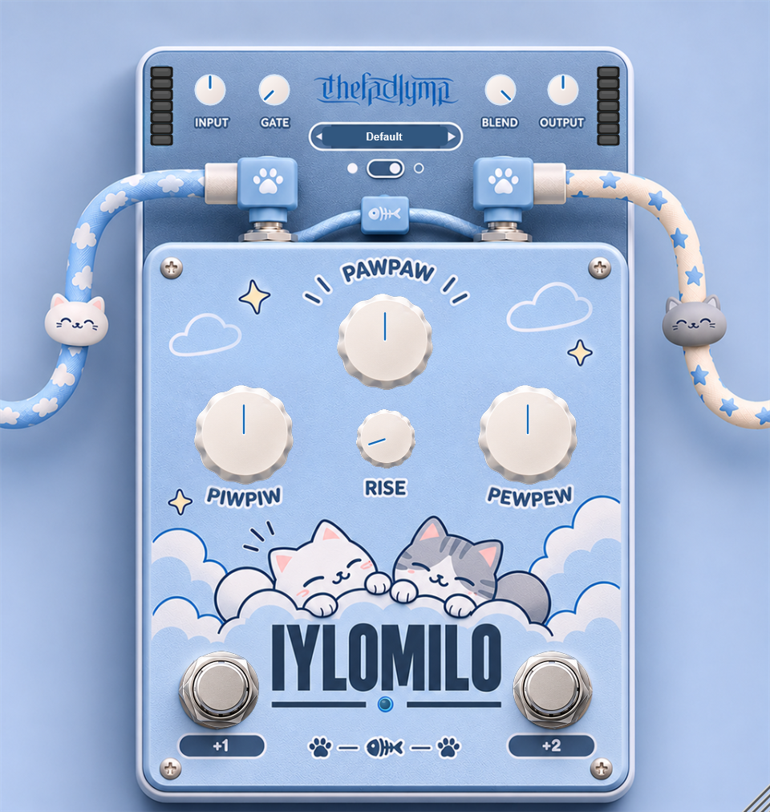

# iylomilo

> Modified rebrand of The Calm by BetaRabbit. Rebranded by thefadlyma on 2026-11-02; the original
> copyright and GNU AGPL-3.0 terms remain in effect.

**An octave pedal that ruins everything, calmly.**

iylomilo shifts your guitar up one or two octaves with a grainy, slightly broken pitch shifter, then lets
you detune it, scramble it and turn it into a resonant mess. It is built for momentary, foot-pressed
octave jumps: hold a switch, the pitch rises; let go, it's back.

<p align="center"></p>

- Formats: **VST3, AU, CLAP** on macOS (Apple Silicon and Intel, macOS 11+);
  **VST3 and CLAP** on Windows (x64; on Windows on ARM they run in x64 and ARM64EC hosts such as REAPER).
- Stereo or mono, any sample rate, low CPU usage.

## Controls

| Control | What it does |
|---|---|
| **+1** | Hold for **+1 octave**. Right-click → **Latch** to make it a toggle. |
| **+2** | Hold for **+2 octaves**. Right-click → **Latch**. Only one octave switch is active at a time. |
| **RISE** | How long the pitch takes to glide up when you press a switch (0 – 1.5 s). Release is instant. Right-click → **Tempo Sync** to set it in note values (1/32 – 2 bars) instead. |
| **PAWPAW** (Chill) | Adds two detuned voices around the octave: from a gentle chorus to dissonant chaos. |
| **PIWPW** (Order) | Random pitch wobble and stutter. Low settings drift, high settings fall apart. |
| **PEWPEW** (Sloth) | A resonant comb in front of the shifter: metallic ringing that grows towards the top of the knob. Combined with Order it turns into a smeared, unstable drone. |
| **INPUT** | Input gain, −24 to +24 dB. |
| **GATE** | Noise gate threshold. Fully left is **Off**. |
| **BLEND** | Dry/wet mix while a switch is engaged. |
| **OUTPUT** | Output gain, −24 to +24 dB. |
| **MONO / STEREO** | Stereo processes each channel; Mono sums to one channel first. |
| Meters | Input (left) and output (right), −30 to 0 dB. |
| LED | Lights while an octave is engaged. |

Tips:
- Hover a knob to see its value; **double-click** resets it. CHILL, ORDER and SLOTH start at 12 o'clock.
- The window can be resized from the corner; its size is remembered with your project.

## Presets

The display at the top shows the current preset; an asterisk means you have changed something since
loading it.

- **‹ ›** step through the presets.
- **Click the display** for the menu: all presets, **Save Preset…**, **Delete**, **Show Presets Folder**.
- Nine factory presets are built in and also appear as the plugin's programs in your DAW.
- Your presets are files in `~/Library/Application Support/iylomilo/Presets` (macOS) or
  `%APPDATA%\iylomilo\Presets` (Windows), so they are easy to back up and share.
- Presets store the sound only: footswitch states, Latch and Mono/Stereo are left as they are.

## MIDI control

Every knob, both footswitches and the Mono/Stereo switch can be played from a MIDI controller or a
footswitch.

1. Right-click the control → **MIDI Learn** (it gets a red outline).
2. Move a controller or press a key/pad — it is assigned.
3. Right-click → **Clear MIDI** removes it.

Footswitches react to CC values ≥ 64 or note-on as "pressed"; in Latch mode each press toggles.
Assignments are saved with your project. In your DAW, route MIDI to the track with iylomilo
(Logic: choose the MIDI source in the plugin window's header).

## Installing

Download the installer for your system from the Releases page.

- **macOS** — `iylomilo-<version>-macOS.pkg`. Click **Customize** to choose formats. The installer is not
  signed: if macOS blocks it, open **System Settings → Privacy & Security** and click **Open Anyway**.
- **Windows** — `iylomilo-<version>-Windows.exe`. Choose VST3 and/or CLAP. Plugins go to
  `C:\Program Files\Common Files\VST3` and `…\CLAP`.

Rescan plug-ins in your DAW if iylomilo doesn't show up.

---

## Building from source

Requires CMake 3.22+ and a C++20 compiler (Xcode command line tools on macOS, Visual Studio 2022 on
Windows). This source bundle includes the JUCE, CLAP, and clap-juce-extensions dependencies pinned by
the upstream v1.0 release; see [docs/DEPENDENCIES.md](docs/DEPENDENCIES.md).

```bash
cmake -B build -DCMAKE_BUILD_TYPE=Release
cmake --build build --config Release
```

On macOS, development builds also copy the plugins to `~/Library/Audio/Plug-Ins`. Remove those copies
when testing an installed build, so hosts don't list iylomilo twice.

Installers:

```bash
tools/make_installer_mac.sh                                            # dist/iylomilo-<version>-macOS.pkg
powershell -ExecutionPolicy Bypass -File tools\make_installer_win.ps1  # dist\iylomilo-<version>-Windows.exe
```

The Windows script builds x64 plugins and needs [Inno Setup](https://jrsoftware.org/isinfo.php) 7.

### Project layout

- `Source/dsp/NoiseEngine.h` — the DSP core, header-only, no JUCE dependency.
- `Source/PluginProcessor.*`, `Source/PluginEditor.*` — plugin wrapper and UI.
- `Source/PresetManager.*`, `Source/MidiLearn.*` — presets and MIDI Learn.
- `Resources/iylomilo_design_base_v2.png` — latest clean base artwork from the updated asset pack.
- `Resources/iylomilo_skin_clean_source_v2.png` — that base artwork normalized to 1024 × 1080.
- `Resources/iylomilo_design_original.png` — earlier full artwork, retained as a reference.
- `Source/SkinLayout.h` — interactive control positions for the artwork.
- `Resources/iylomilo_skin_clean_v2.png` — current embedded background generated from the clean base by
  `tools/prepare_skin.py`. Re-run it after replacing the design; update `Source/SkinLayout.h` if controls move.
- Earlier background versions are retained under the previous `iylomilo_skin_clean*.png` and `skin*.png` filenames.
- `Resources/iylomilo_knob_*.png` — the transparent knob caps supplied for PAWPAW, PIWPIW,
  PEWPEW and RISE; their blue pointers are rendered live by the plugin.
- `Resources/iylomilo_footswitch_off.png` and `Resources/iylomilo_footswitch_on.png` — the
  transparent footswitch graphics for the released and pressed states.
- `installer/iylomilo.iss` — Windows installer (Inno Setup).

### Tests and tools

- `calm_tests` — MIDI Learn, presets, defaults, editor size (`build/calm_tests_artefacts/Release/calm_tests`).
- `calm_stress` — CPU table and a randomized torture test (automation, presets, block sizes, sample rates).
- `ui_snapshot` — renders the UI to PNG without a host: `ui_snapshot out.png 600 preset="Nap Time" octave1=1`.
- `calm_render` — runs the DSP core offline on WAV files.
- `tools/*.py` — test signals, capture matrices through any plugin (via
  [pedalboard](https://github.com/spotify/pedalboard)), and analysis/A-B comparison of pitch, rise,
  modulation and spectra. Set up with `python3 -m venv .venv && .venv/bin/pip install numpy scipy soundfile matplotlib pedalboard`.

## License

Copyright © 2026 BetaRabbit. Rebranding and source changes © 2026 thefadlyma.

This modified version of The Calm was rebranded as iylomilo by thefadlyma on 2026-11-02. It is
released under the **GNU Affero General Public License v3.0** as published by the Free Software Foundation. It is
distributed in the hope that it will be useful, but WITHOUT ANY WARRANTY; see [LICENSE](LICENSE).

Third-party components keep their own licences: JUCE (AGPLv3 / commercial), clap-juce-extensions and
the CLAP SDK (MIT), the VST3 SDK (MIT).

Built with [JUCE](https://juce.com) and [clap-juce-extensions](https://github.com/free-audio/clap-juce-extensions).
VST is a registered trademark of Steinberg Media Technologies GmbH.
